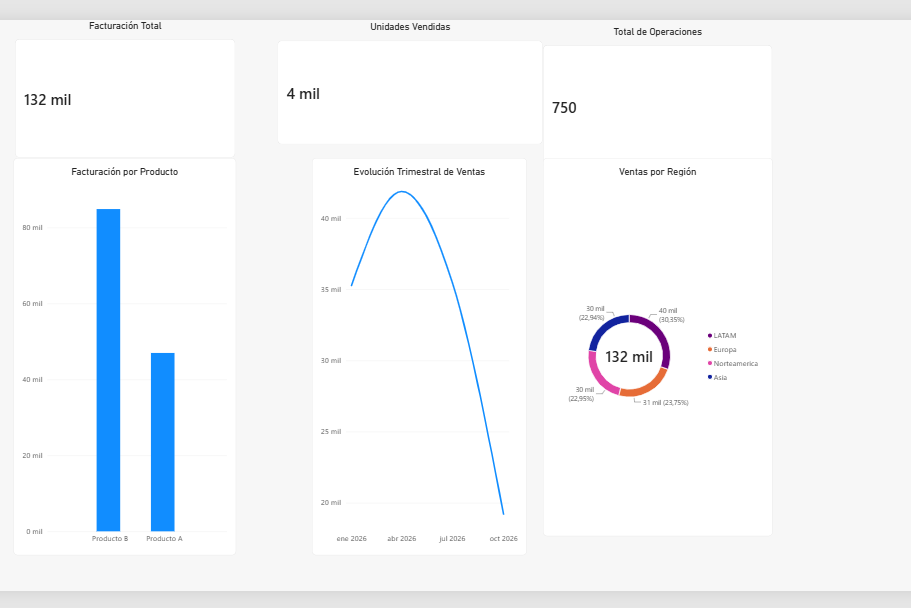

# proyecto-ecommerce-sql-python
Limpieza, transformación y análisis de ventas de e-commerce utilizando Python, SQLite y hojas de cálculo y Claude AI
## 🛠️ Herramientas y Flujo de Trabajo

* **Python (`reconstruir_perfecto.py`):** Limpieza de duplicados, cálculo automático de ingresos totales y generación de fechas consistentes.
* **SQL (`tienda.db`):** Almacenamiento estructurado y consultas en base de datos relacional SQLite.
* **Excel (`REPORTE_FINAL_LISTO.xlsx`):** Procesamiento de datos, tablas dinámicas y análisis comercial.
* **Google Sheets:** [Ver Planilla y Dashboard Interactivo](https://docs.google.com/spreadsheets/d/1K4KZZkMq0yav-tKgX9b7NxVcHu3DgCCl/edit?usp=sharing&ouid=112482477063976080655&rtpof=true&sd=true)

## 📊 Visualización y Tablero Ejecutivo (Power BI)

Como cierre del flujo End-to-End (limpieza y automatización en **Python**, modelado en **SQL** y visualización en **Power BI**), se desarrolló un dashboard interactivo para el seguimiento comercial:

### 🎯 KPIs e Insights Principales del Negocio:
* **Facturación Total:** $132.000 generados a través de **750 operaciones** y **4.000 unidades vendidas**.
* **Liderazgo de Producto:** El **Producto B** lidera ampliamente la facturación ($85 mil), superando casi al doble al **Producto A** ($47 mil).
* **Estacionalidad Trimestral:** Se observa un pico máximo de ventas en el **segundo trimestre (abril)** seguido de una caída marcada hacia el cierre del año, detectando una oportunidad concreta de campañas comerciales para Q3–Q4.
* **Distribución Regional Equilibrada:** **LATAM (30,35%)** encabeza los ingresos, seguida de manera pareja por **Asia (23,75%)**, **Europa (22,95%)** y **Norteamérica (22,94%)**.
* **Consultas SQL de Negocio:** Podés revisar las queries de KPIs, geografía y segmentación de clientes directamente en [`consultas.sql`](resultados_sql.md).
